# 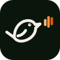 Chirp — Automated Bird Call Detection System

**Chirp** is an end-to-end, edge AI–powered system for automated bird call detection,
identification, and archival. It runs entirely on your own hardware — no cloud
subscriptions, no data sharing.

**Author:** Joshua Salvi — josh.salvi@gmail.com  
**Version:** 0.5.14.h  
**Status:** Active development · [ourchirp.com/about](https://ourchirp.com/about)

---

## 🧠 How It Works

> **Getting started:** build a station from [chirp-device/README.md](chirp-device/README.md), then either
> run your own server ([setup guide](https://ourchirp.com/setup.html#server), `chirp-server-instances/docker-compose.simple.yml`) or
> [request a hosted site on ourchirp.com](https://ourchirp.com/about#start).
> Self-hosted servers can request a push relay token there so the iPhone app
> gets notifications.

Chirp splits into two pieces: a lightweight **edge sensor node** (the
physical device with microphones attached, typically a Raspberry Pi) that
listens continuously and decides what's worth recording, and a **server
subsystem** (this Docker container) that stores everything, enriches
detected species with data from several public sources, and serves the
web dashboard.

<p align="center"></p>

Detection itself runs as a two-stage pipeline on the edge device: a cheap,
fast energy filter screens out the overwhelming majority of incoming
audio (silence, wind, unrelated noise) before the expensive neural
network classifier ever runs — this is what makes continuous, always-on
detection practical on modest hardware instead of needing a full-scale
classifier running on every moment of audio all day.

<p align="center"></p>

For the full technical breakdown — real configuration values, the
species enrichment sequence, API reference, and troubleshooting — see the
**[full technical documentation guide](techdocs/)** (built with MkDocs;
`cd techdocs && mkdocs serve` to view locally).

---

## 📱 Screenshots

Mobile (iOS app / installed PWA) — a sample across the app. All screenshots below
have identifying information (account details, exact home address, device network
info) removed or blacked out.

<table>
<tr>
<td>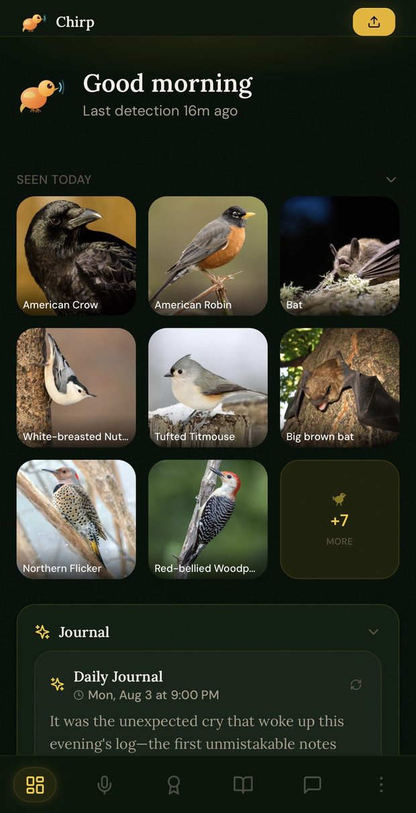</td>
<td>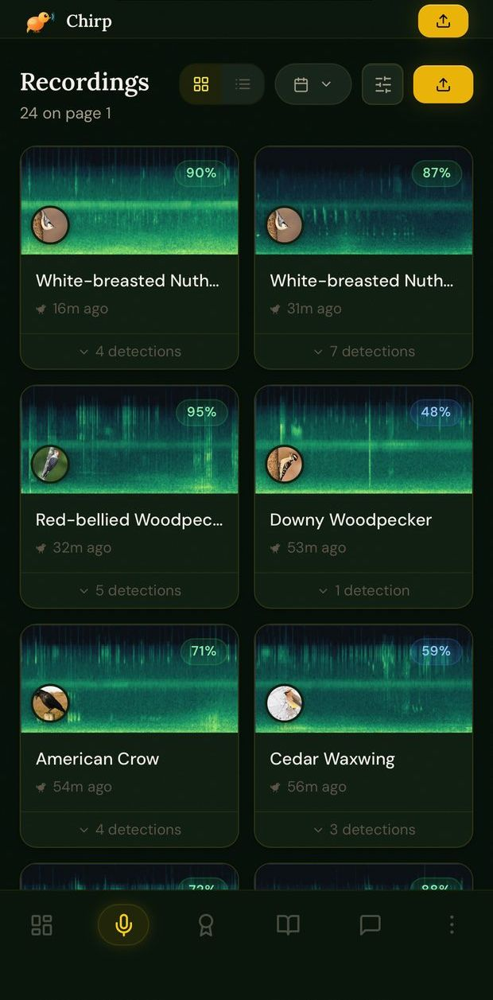</td>
<td>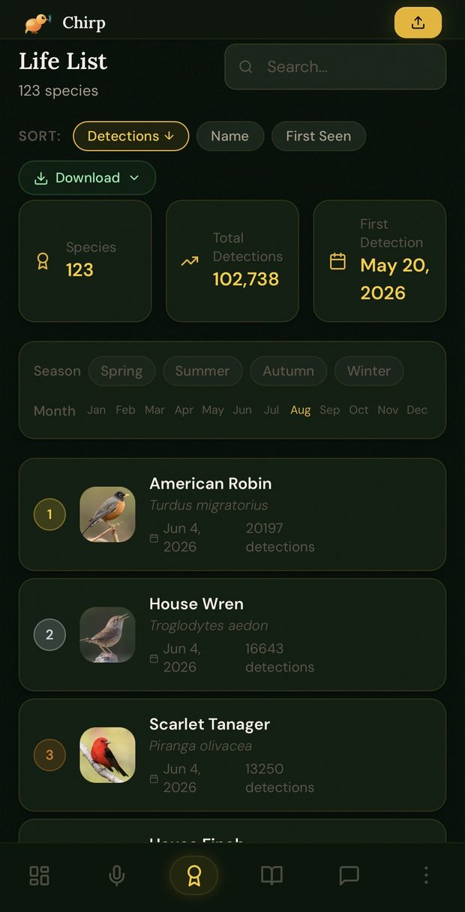</td>
</tr>
<tr>
<td align="center"><sub>Dashboard</sub></td>
<td align="center"><sub>Recordings</sub></td>
<td align="center"><sub>Life List</sub></td>
</tr>
<tr>
<td>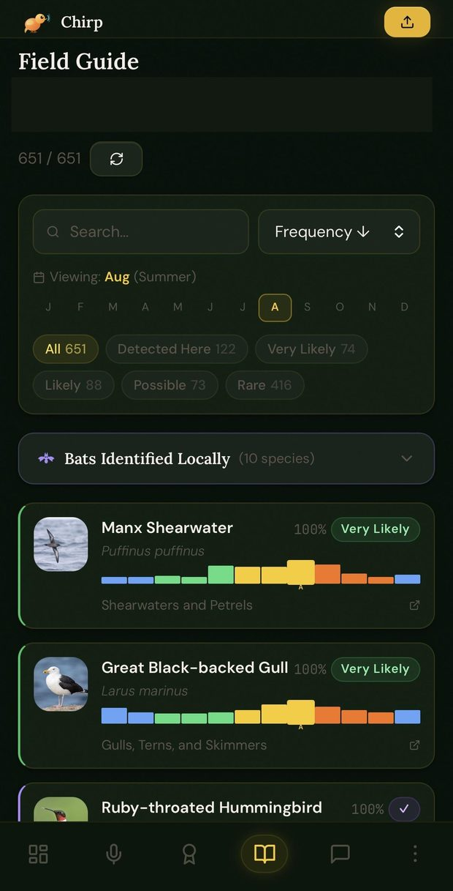</td>
<td>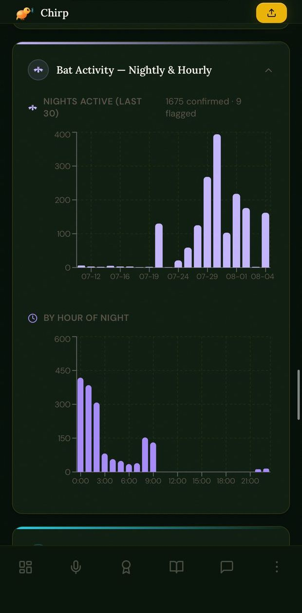</td>
<td>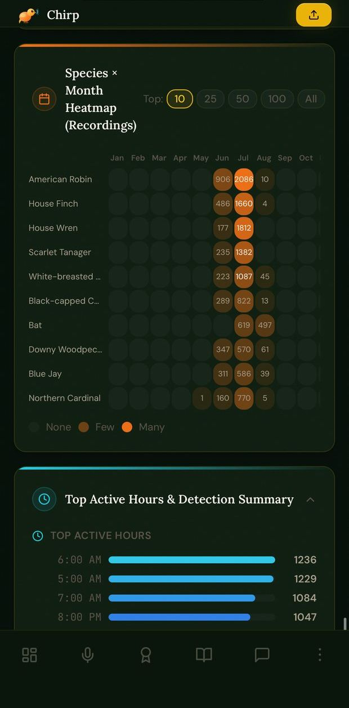</td>
</tr>
<tr>
<td align="center"><sub>Field Guide</sub></td>
<td align="center"><sub>Bat activity</sub></td>
<td align="center"><sub>Statistics</sub></td>
</tr>
<tr>
<td>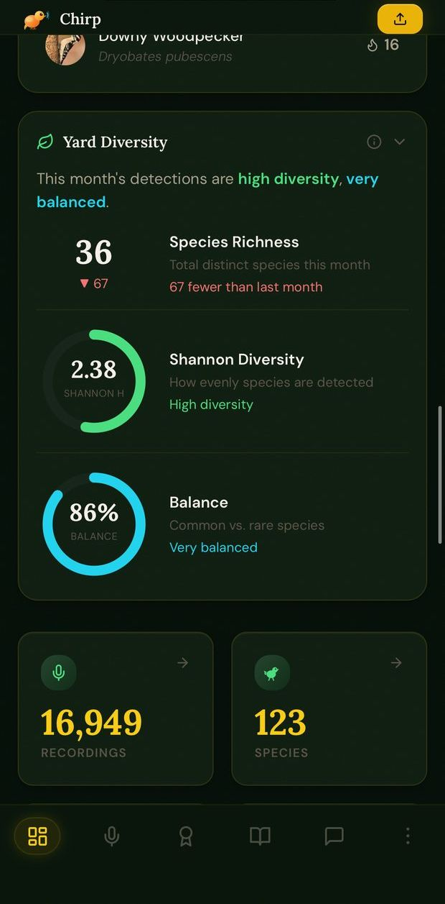</td>
<td>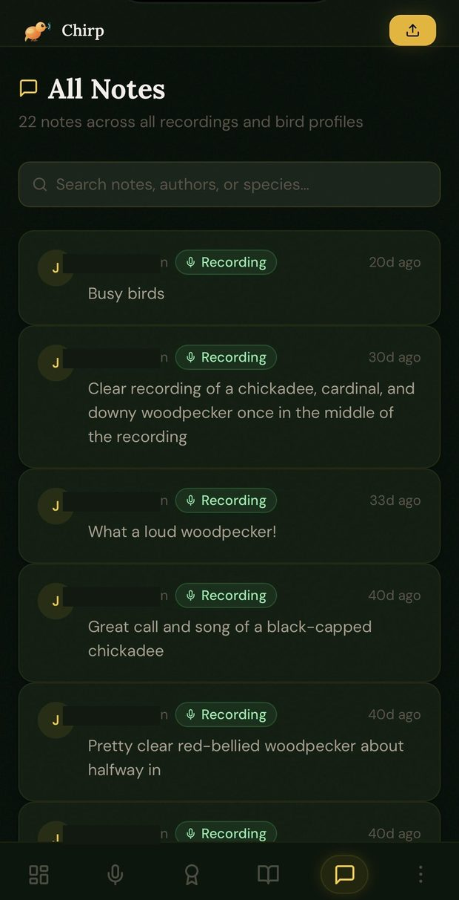</td>
<td>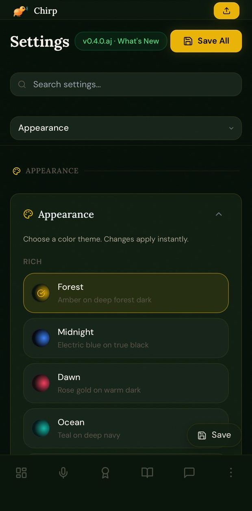</td>
</tr>
<tr>
<td align="center"><sub>Yard diversity</sub></td>
<td align="center"><sub>Notes</sub></td>
<td align="center"><sub>Settings &amp; themes</sub></td>
</tr>
</table>

Desktop (web browser) — the same real app, same real data, at desktop width.

<table>
<tr>
<td>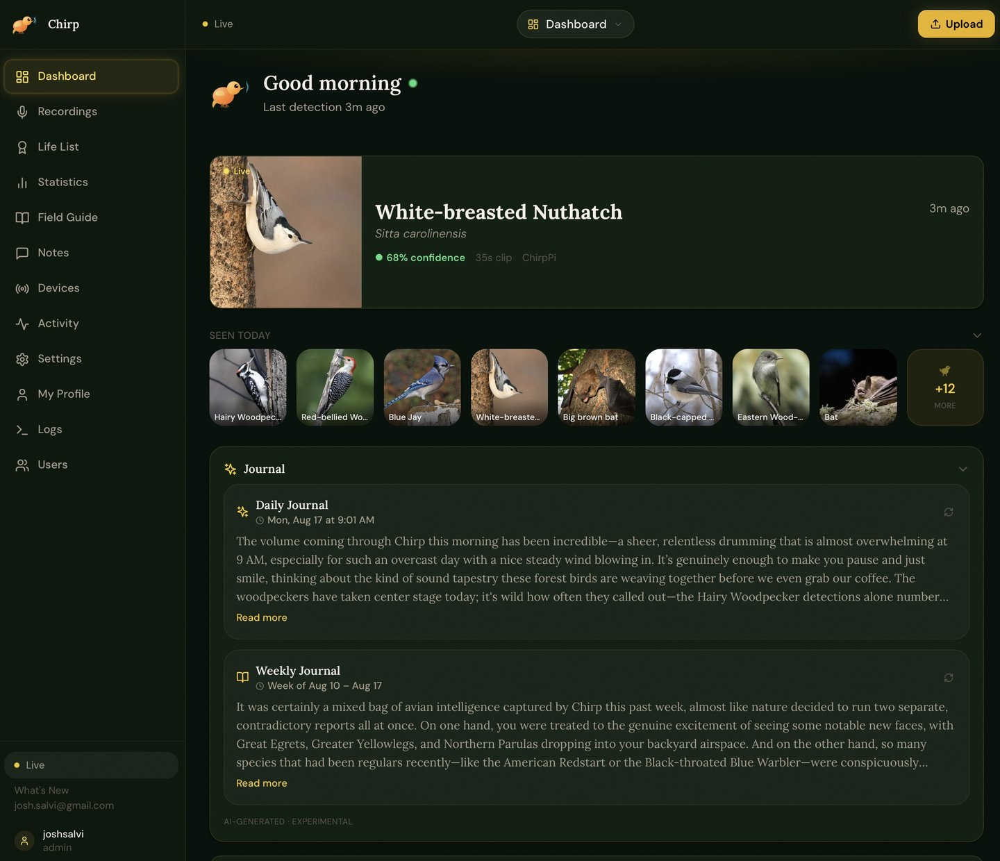</td>
<td>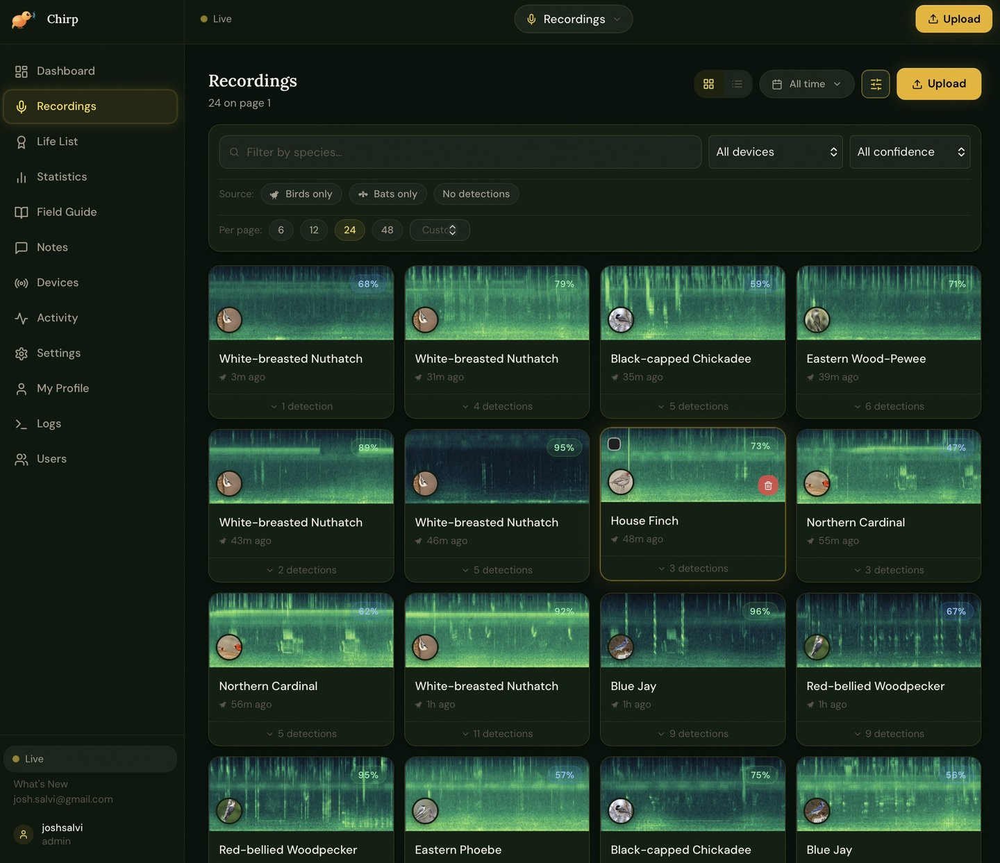</td>
</tr>
<tr>
<td align="center"><sub>Dashboard</sub></td>
<td align="center"><sub>Recordings</sub></td>
</tr>
<tr>
<td>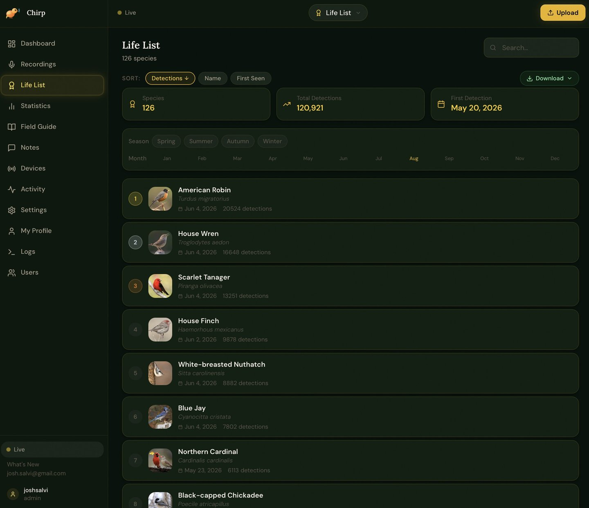</td>
<td>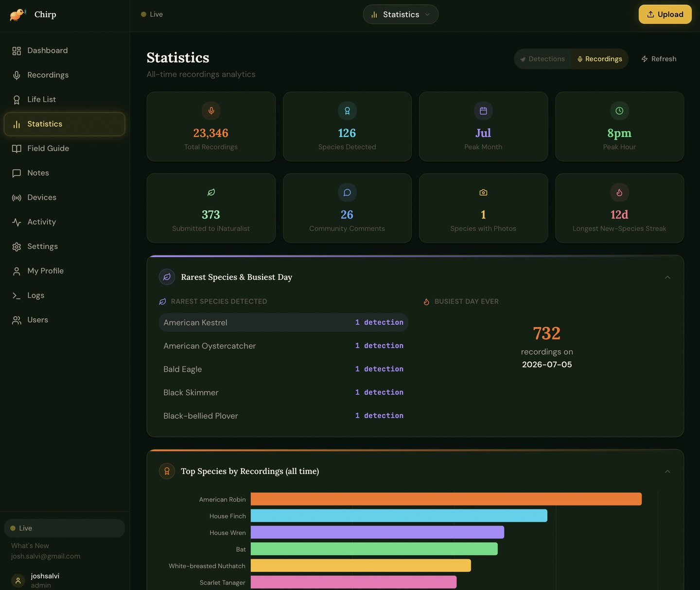</td>
</tr>
<tr>
<td align="center"><sub>Life List</sub></td>
<td align="center"><sub>Statistics</sub></td>
</tr>
<tr>
<td>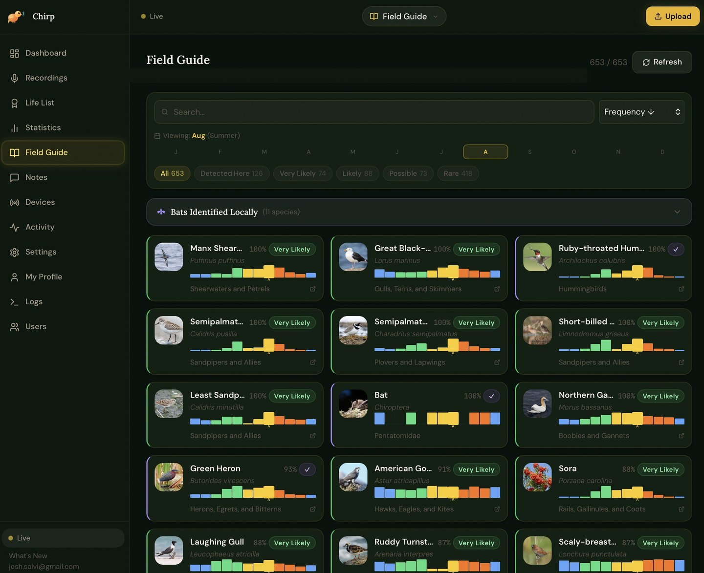</td>
<td>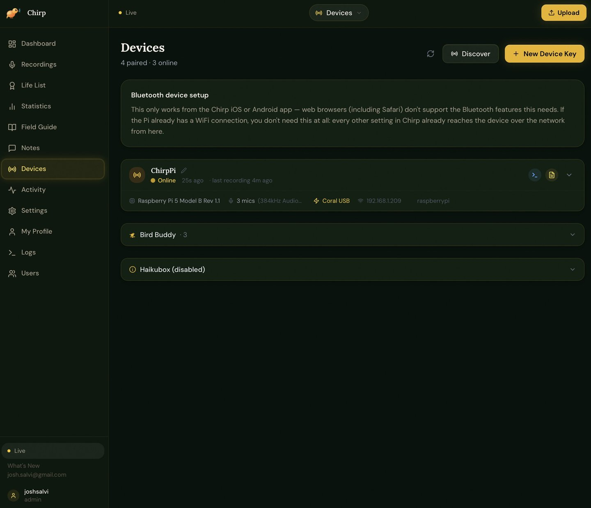</td>
</tr>
<tr>
<td align="center"><sub>Field Guide</sub></td>
<td align="center"><sub>Devices</sub></td>
</tr>
</table>

The full set (20 screenshots, including Devices, Logs, admin Activity, Weekly
Summary, Life List growth, confidence distributions, and more) is in
[`docs/screenshots/mobile/`](docs/screenshots/mobile/).

**Desktop screenshots aren't included yet** — the web app is fully responsive and
works the same way in a desktop browser, but no desktop captures have been taken
for this README so far. If you'd like to contribute some, a PR adding
`docs/screenshots/desktop/` in the same style would be very welcome.

---

## 📂 Documentation

| Document | Description |
|---|---|
| **[chirp-device/README.md](chirp-device/README.md)** | Raspberry Pi 5 setup — installation, config, microphones, Coral |
| **[BAT_WOBBLE_INVESTIGATION.md](BAT_WOBBLE_INVESTIGATION.md)** | The ongoing interference investigation, consolidated — what's confirmed, what's ruled out, what's next |
| **[HARDWARE_MIC_UPGRADE.md](HARDWARE_MIC_UPGRADE.md)** | Combined low-noise bird + ultrasonic bat mic build — weatherproof, AC-powered, Maine-to-Florida climate rated, step-by-step |
| **[docs/REMOTE_DEVICES.md](docs/REMOTE_DEVICES.md)** | Managing a device that isn't on the server's LAN — self-hosted Tailscale/Headscale mesh, bundled in chirp-server-instances |
| **[chirp-server/MULTI_INSTANCE.md](chirp-server/MULTI_INSTANCE.md)** | Multiple locations/tenants — one real chirp-server instance per location, the current recommended approach |
| **[docs/MULTI_SERVER_DEVICE.md](docs/MULTI_SERVER_DEVICE.md)** | Sending one chirp-device's data to more than one server at once (e.g. two different chirp-server instances) |
| **[docs/CLOUDFLARE_TUNNEL.md](docs/CLOUDFLARE_TUNNEL.md)** | HTTPS setup — the default for both projects. No port forwarding, no open ports. Genuinely required for Web Push and native APNs push to work at all, not optional hardening. |
| **[Setup guide](https://ourchirp.com/setup.html)** | Station, server and app, step by step (also `chirp-server-instances/frontend/public/setup.html`) |
| **[User guide](https://ourchirp.com/guide.html)** | Every page and setting in the app |
| **[chirp-server/README.md](chirp-server/README.md)** | The older single-site server (deprecated) |
| **[CHANGELOG.md](CHANGELOG.md)** | Full version history with all changes per release |
| **[LICENSE](LICENSE)** | PolyForm Noncommercial 1.0.0 |

---

## 🗂️ Components

| Directory | Description |
|---|---|
| `chirp-device/` | Raspberry Pi 5 agent — mic capture, BirdNET inference (+ Coral EdgeTPU), upload |
| `chirp-server/` | Older single-site server (deprecated; use chirp-server-instances) |
| `chirp-server-instances/` | **The Chirp server.** Multi-site — one shared app with per-tenant databases and a Global Admin panel, rather than N fully independent containers. See its own `ARCHITECTURE.md` and the Tech Docs "System Architecture" page's "Supporting infrastructure containers" section for its bundled Headscale/Caddy/cloudflare-ddns. |
| `figures/` | Ten technical diagrams covering system architecture, the detection pipeline, and other subsystems |

---

## 🔢 Versioning

Chirp uses a four-part version number: **`0.X.Y.Z`**

```
  0 . 1 . 3 . d
  │   │   │   └─ Patch letter  (a b c d …)
  │   │   └───── Minor version (0, 1, 2, 3 …)
  │   └───────── Major version (0, 1, 2 …)
  └───────────── Epoch         (always 0 until public commercial launch)
```

### What each position means

**Epoch `0`** — The leading zero means Chirp is in pre-commercial development.
It becomes `1` at the first stable public/commercial release. Think of it as
"Chapter 0: still building."

**Major `X`** — Increments when something breaks backwards compatibility or
requires a significant manual step from you: a database migration you have to
run yourself, a renamed config key, a hardware requirement change, or a
fundamental architectural rewrite. You will always see a clear note in the
changelog when X changes.

**Minor `Y`** — Increments when a new user-visible feature is added. New pages,
new integrations (e.g. iNaturalist submission, SSH terminal, eBird export), new
hardware support. The system still works the same way, just has more capabilities.

**Patch `Z`** — A letter (`a`, `b`, `c`, `d` …) that resets to `a` whenever
Y increments. Patch releases contain only fixes and small improvements within
the same feature set:

| Letter | Meaning | Typical contents |
|---|---|---|
| `a` | Initial | First release of this X.Y |
| `b` | Bugfix | Stability patches, error handling |
| `c` | Critical | Hotfixes for crashes, data loss, or security issues |
| `d` | Developer | Audits, documentation, tooling, no user-facing change |
| `e` | Enhancement | UX polish, performance, no new features |
| `f` onwards | Extended patch | Additional fixes if needed before next minor |

### Reading examples

| Version | What it means |
|---|---|
| `0.1.0.a` | First ever release of Chirp (initial launch) |
| `0.1.2.c` | Third patch of the second minor release — a critical hotfix |
| `0.1.3.d` | An early developer/audit pass, no user-facing change |
| `0.5.0.p` | Current version |
| `0.2.0.a` | First release with a major new feature epoch |
| `1.0.0.a` | First public/commercial stable release |

### Where to find the version

- **In the app:** Bottom of the sidebar — "v0.5.0.p · What's New"
- **In the app:** Settings → About, or click "What's New" for full changelog
- **In the code:** `chirp-server/frontend/package.json` → `"version"`
- **In the API:** `GET /api/v1/health` → `{"version": "0.5.0.p"}`
- **In the changelog:** [CHANGELOG.md](CHANGELOG.md)

### How to update the version

When making a release, update these three files consistently:

```bash
# 1. chirp-server/frontend/package.json
"version": "0.X.Y.Z"

# 2. chirp-server/app/main.py
version="0.X.Y.Z"

# 3. CHANGELOG.md — add a new ## 0.X.Y.Z section at the top
```

---

## ⚡ Quick Setup

### 1. Server (Unraid / any Docker host)
```bash
cd chirp-server
cp .env.example .env
# Edit .env: set CHIRP_SECRET_KEY, CHIRP_DEVICE_API_KEY
docker-compose up -d --build
# WebGUI: http://YOUR_SERVER_IP:8765
```

See **[chirp-server/README.md](chirp-server/README.md)** for full environment variable
reference and volume paths.

### 2. Device (Raspberry Pi 5)
```bash
cd chirp-device
./install.sh              # CPU-only
# ./install-coral.sh      # With Google Coral EdgeTPU (~8x faster)
# Edit config.yaml: set upload.server_url and upload.api_key
python main.py --test-detection
python main.py            # Start detecting!
```

See **[chirp-device/README.md](chirp-device/README.md)** for full installation
instructions, configuration options, and Coral setup.

### 3. Configure in the WebGUI
Open `http://YOUR_SERVER_IP:8765` → Settings:
- Set your **location** (enables eBird regional data)
- Add your **eBird API key** (free at ebird.org/api/keygen)
- Configure **SMTP** if you want email notifications

---

## 🔑 API Keys Needed

| Key | Where to get | Used for |
|---|---|---|
| eBird API key | [ebird.org/api/keygen](https://ebird.org/api/keygen) | Field Guide, trends, species likelihood |
| iNaturalist token | [inaturalist.org/users/api_token](https://www.inaturalist.org/users/api_token) | Submitting observations |

---

## 🤖 AI Features (Optional) — Anthropic / OpenAI / Gemini / Ollama

Three optional features run on an LLM, each independently assignable to a provider in **Settings → AI Features**, off by default:

| Feature | Type | What it does |
|---|---|---|
| Daily Journal | Text | A short, personality-driven daily summary of what showed up |
| Bird Profile Summaries | Text | A presence summary on each species' profile page |
| Call Re-analysis (**AI Second Opinion** button, in the UI) | **Vision** | Shows the model a spectrogram image as a second opinion on an uncertain detection |

**Important architectural note before picking a model:** unlike the hosted providers, Ollama has **one shared `base_url` + `model` setting**, not a separate model per feature — you pick a *provider* per feature, but every feature assigned to "ollama" uses that same single model. Since Call Re-analysis needs a vision-capable model and the other two are text-only, this leaves two real strategies:

- **A. One model does everything** — pick a vision-capable model (they handle plain text fine too) and assign all three features to Ollama.
- **B. Split it** — assign Daily Journal + Bird Profile Summaries to Ollama with a fast text-only model, and leave Call Re-analysis on a hosted provider (Anthropic/OpenAI/Gemini). Local vision models are noticeably behind frontier hosted models on fine-grained visual judgment calls like "does this spectrogram support this species guess" — Strategy B trades a few cents per re-analysis for meaningfully better judgment on the one feature where a wrong answer is most misleading.

There's no wrong choice here — B is the more accuracy-conscious pick, A is the fully self-hosted/zero-cost pick.

### Audio cleanup — not LLM features, but AI-adjacent

Every recording's audio player also has two or three toggles that clean
up the audio itself, separate from the three LLM features above (no
provider or API key involved for either):

| Toggle | How | Notes |
|---|---|---|
| Enhanced | Classical spectral-gating noise reduction | Learns a noise profile from the recording itself |
| Rumble Removed | A species-aware high-pass filter | Cuts low-frequency rumble (traffic, wind, HVAC) specifically; a manual 0–2000Hz slider overrides the automatic cutoff, matching Live Detect's own rumble filter |
| AI Enhance (Experimental) | A local neural-network model (biodenoising, Demucs-based) | A full alternative to Enhanced/Rumble Removed, not combined with them — enable in Settings → AI Features. Runs at 16kHz internally, so very high-frequency detail above 8kHz is lost in the result. |

Enhanced and Rumble Removed can be combined; AI Enhance always replaces both when it's on.

### Setting up Ollama

**1. Install** (bare-metal or Docker — if you're running the rest of Chirp on Unraid, Docker is the natural fit):
```bash
# Bare-metal (Linux):
curl -fsSL https://ollama.ai/install.sh | sh

# Or Docker:
docker run -d --gpus=all -v ollama:/root/.ollama -p 11434:11434 --name ollama ollama/ollama
```

**2. Give the container your GPU.** Docker doesn't expose a GPU to a container by default, even with working host drivers — this is the single most common reason Ollama silently runs on CPU with no error. On Unraid: install the **Nvidia-Driver** plugin (Community Applications) first, then make sure the container actually requests the GPU. In docker-compose:
```yaml
services:
  ollama:
    image: ollama/ollama
    ports:
      - "11434:11434"
    volumes:
      - ollama:/root/.ollama
    deploy:
      resources:
        reservations:
          devices:
            - driver: nvidia
              count: all
              capabilities: [gpu]
volumes:
  ollama:
```

**3. Pull a model** (see the table below), then confirm it's actually on the GPU:
```bash
ollama pull <model>
ollama ps          # PROCESSOR column should show 100% GPU, not CPU
nvidia-smi         # confirm an ollama process is using VRAM while generating
```

**4. Configure in Chirp** — Settings → AI Features → set Ollama's base URL (e.g. `http://192.168.1.X:11434` — use the host's LAN IP, not `localhost`, if Ollama runs in a separate container from chirp-server) and model name, then assign whichever features you want to it.

### Which Ollama model should you use?

Model names, sizes, and exact VRAM figures shift often — always double-check current tags with `ollama pull <name>` (it'll error clearly if the tag doesn't exist) or at [ollama.com/library](https://ollama.com/library) before committing. Figures below are Q4 quantization estimates, treat as a floor rather than exact:

| Model | Type | Approx. VRAM | Pros | Cons |
|---|---|---|---|---|
| `gemma4:e2b` | Vision + text | ~2–4 GB | Runs on almost anything; genuinely multimodal, not a bolted-on vision head | Weakest reasoning of the family — fine for short summaries, shakier on nuanced spectrogram judgment |
| `gemma4:e4b` | Vision + text | ~6–8 GB | Best quality-per-GB tradeoff for a modest GPU; still fast | Meaningfully behind the larger tiers on fine visual detail |
| `gemma4:26b` (MoE, ~4B active) | Vision + text | ~16–20 GB | Strong quality while staying fast (MoE only activates a fraction of params per token) | Needs a real GPU; larger download |
| `gemma4:31b` | Vision + text | ~20–24 GB+ | Best quality in the family; dense model, no MoE inconsistency | Needs a high-end GPU; slower per-token than the MoE tier |
| `llama3.2-vision:11b` | Vision + text | ~8–10 GB | Mature, widely tested, stable in Ollama | Vision quality trails Gemma 4 at a comparable size |
| `llama3.2-vision:90b` | Vision + text | ~48 GB+ | High quality | Needs serious multi-GPU hardware — unrealistic for most home setups |
| `llama3.3:8b` | Text only | ~6–8 GB | Fast, well-rounded, best all-around *text* choice if you're going with Strategy B | No vision — can't be used for Call Re-analysis at all |
| Qwen2.5-VL (7B) | Vision + text | ~6–8 GB | Strong document/chart understanding | Newer Qwen 3.5/3.6 vision variants are **currently broken in Ollama specifically** (the text half loads fine, but the vision sidecar isn't wired up) — stick to Qwen2.5-VL or Qwen3-VL if going this route, not 3.5/3.6 |

**Our recommendation:** given you already have GPU passthrough working, `gemma4:e4b` (Strategy A, one model for everything) is the best starting point — genuinely multimodal, fast, and modest on VRAM. If Call Re-analysis's judgment calls matter to you and you have the VRAM to spare, `gemma4:26b` is a meaningful step up for that feature specifically. If you'd rather keep Call Re-analysis on a hosted provider and just want Ollama for the two text features (Strategy B), `llama3.3:8b` is the better dedicated pick — it won't be doing double duty as a vision model it doesn't need to be.

---

## 🏗️ Architecture

```
Raspberry Pi 5 (chirp-device)
  ├── USB/M.2 Coral TPU (optional, ~8x faster)
  ├── ReSpeaker USB microphone (primary — detection path)
  ├── Additional USB mics (optional — SNR-weighted recording path)
  ├── BirdNET TFLite — 2-stage detection (energy filter → neural classifier)
  └── → uploads WAV + JSON metadata → chirp-server

Unraid Docker (chirp-server, port 8765)
  ├── FastAPI backend  /app/app/api/
  │   ├── recordings.py    — upload, analysis, statistics
  │   ├── birds.py         — profiles, life list, eBird export
  │   ├── devices.py       — Pi pairing, config push, SSH terminal
  │   └── app_settings.py  — settings, backup / restore
  ├── Services
  │   ├── bird_enricher.py  — Wikipedia, iNat, eBird, Xeno-canto, BirdLife
  │   ├── geomodel_service  — iNat GeoPackage range map rendering
  │   ├── email_service.py  — SMTP notifications
  │   └── inat_service.py   — iNaturalist observation submission
  └── React/Vite PWA  (served at /)
```

---

## 🎙️ Microphone Options — Full Comparison

The ReSpeaker XVF3800 (Chirp's default mic) publishes a **64 dBA SNR** spec, not
a self-noise figure — it's a digital MEMS array with on-chip DSP (AEC/AGC/
beamforming/noise suppression), so its numbers aren't measured the same way as
a plain analog capsule's. Several fields below aren't published by the
manufacturer in a directly comparable form (marked accordingly) rather than
guessed at, and "effective range" genuinely isn't a standardized spec across
this category — it depends on the sound source's own loudness/directivity and
whether a reflector is involved.

| Mic | Cost | Interface | Directionality | Self-noise | SNR | Effective range | Key features |
|---|---|---|---|---|---|---|---|
| **ReSpeaker XVF3800** *(Chirp default)* | ~$50 | USB (Audio Class 2.0) | 4-mic circular array — omnidirectional with **digital beamforming/DoA** (steerable, not a fixed pattern) | Not published (digital MEMS array) | 64 dBA | N/A — array + beamforming behavior, not a simple mic spec | On-chip AEC/AGC/noise suppression, 5m far-field pickup, plug-and-play, 16kHz max sample rate (a real ceiling for high-pitched calls) |
| **AudioMoth USB Microphone** | ~$50–70 | USB | Omnidirectional | Not officially published — measured higher than dedicated recorders in an independent comparison study | Not published | Short-range general nature recording | Purpose-built for unattended bioacoustic work; already used for bats in Chirp; supports external mic input on newer versions |
| **Primo EM272Z1** *(Clippy/Pluggy)* | ~$100–150 | 2-wire plug-in-power (mini) or XLR w/ phantom power (Pluggy) | Omnidirectional | **14 dBA** | 80 dB @ 1kHz | Close-range/clip-on; extends well with a parabolic reflector | Best noise-per-dollar in field recording; tiny 10mm capsule; widely used DIY/semi-pro standard |
| **Sennheiser MKH 8020** | ~$1,500+ | XLR, needs 48V phantom power | Omnidirectional (cardioid/supercardioid modules also available in the 8000 series) | **10 dBA** (DIN, A-weighted) | Not published as one number — excellent dynamic range instead | Long — flat response and low noise hold up at distance in quiet settings | RF condenser design (immune to humidity noise other condensers get); 10Hz–60kHz response; modular capsule system |
| **Wildlife Acoustics Song Meter SM4** | ~$700–900 | Standalone recorder — 2 built-in mics + 2 cabled mic/hydrophone ports | Omnidirectional (built-in); cabled mic optional for distant placement | Not published separately from SNR | **80 dB typ. @ 1kHz** (1 Pa, A-weighted) | Every +6dB of SNR roughly doubles usable detection distance (WA's own rule of thumb) | Fully standalone (no Pi needed) — weatherproof, D-cell battery (up to 650hrs), dual SD failover, scheduled recording |
| **Dodotronic Ultramic 192K** | ~$250–280 | USB (Audio Class, plug-and-play) | Omnidirectional | "Low noise" (no dB figure published) | Not published | Short-range point-source ultrasonic detection (bats, insects, rodents) | Purpose-built ultrasonic USB mic, 192kHz sampling, 16-bit — a genuine drop-in upgrade over AudioMoth for the bat pipeline specifically |

**Bottom line:** for the birds pipeline, the EM272Z1-based mics are the
standout value — a fraction of the MKH 8020's price for self-noise within
striking distance of it. For the bats pipeline, the Dodotronic Ultramic is
the most direct upgrade over the stock AudioMoth. If you want a completely
separate, no-Pi-required deployment instead, the Song Meter SM4 is the
industry-standard standalone option.

---

## 🐦 Key Features

| Feature | Details |
|---|---|
| ⚡ Edge AI | BirdNET TFLite + optional Google Coral TPU (~8x speedup) |
| 🎵 Pre-roll capture | 5-second circular buffer — never miss a call onset |
| 🔀 Dual-path audio | Separate detection path (primary mic) and recording path (SNR-weighted mix) |
| 🌈 Spectrograms | Mel-scale with per-species detection overlays |
| 🔬 Server re-analysis | Second-opinion BirdNET pass with location + date filtering |
| 🤖 AI Features (optional) | Daily Journal, profile summaries, spectrogram re-analysis — Anthropic/OpenAI/Gemini/Ollama, off by default |
| 🐦 Species enrichment | Auto-pulls eBird, Xeno-canto, iNaturalist, Wikipedia, BirdLife |
| 🗺️ Range maps | Three sources — All About Birds, iNat Geomodel, BirdLife — with per-source toggle |
| 📍 Location-aware | eBird regional species with monthly frequency data |
| 🔔 Live notifications | WebSocket push + email for new species / daily digest |
| 🌿 iNaturalist submit | One-click sound observation upload |
| 📤 eBird export | Download life list as importable CSV |
| 💾 Backup & restore | One-click database backup / restore |
| 🖥️ SSH terminal | In-browser terminal to any paired Pi |
| 📱 PWA | Installable on iOS, Android, desktop |
| 🔐 Auth | Optional login — admin / submitter / viewer roles |

---

## 👤 User Roles

| Role | Permissions |
|---|---|
| **Admin** | Everything — settings, user management, iNat submit, backup/restore, SSH |
| **Submitter** | All views + iNaturalist submission + recording upload |
| **Viewer** | Read-only — recordings, life list, bird profiles, notes |

---

## 📜 License

Copyright © 2026 Joshua Salvi. Licensed under the
[PolyForm Noncommercial License 1.0.0](LICENSE): free to use, modify and run
for any noncommercial purpose, including your own station and server.
Commercial use needs written permission: josh.salvi@gmail.com
