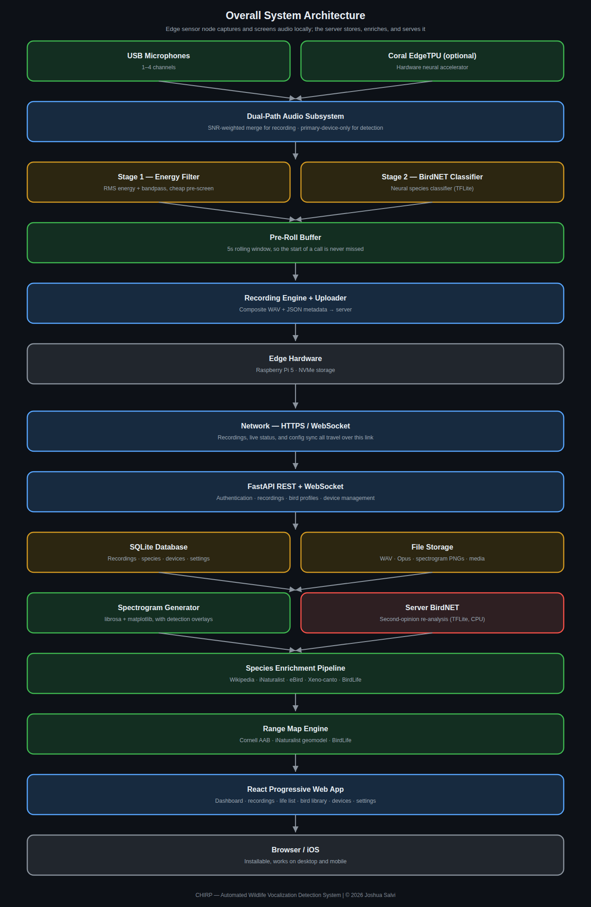
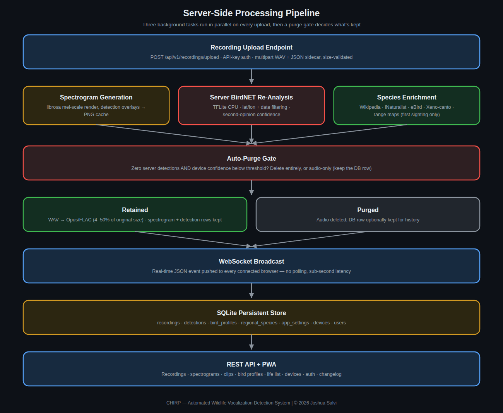
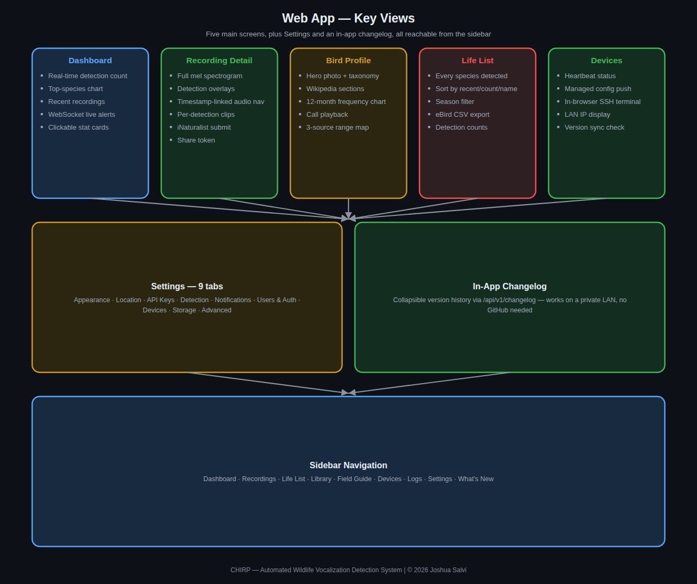

# System Architecture

Chirp splits into two independent pieces that communicate over the
network: an **edge sensor node** (the physical device deployed outdoors
or wherever microphones are placed) and a **server subsystem** (a
self-hosted service that stores, enriches, and serves everything through
a web dashboard).

## Edge Sensor Node

The edge node is a Raspberry Pi–class single-board computer running a
Python daemon. Its job is narrow and deliberately lightweight: capture
audio, decide whether something worth recording just happened, and if so,
package and upload a clip. It does **not** do full species enrichment,
range-map lookups, or long-term storage — all of that is the server's job.

- **USB Microphones** — one to several USB audio input devices, matched
  and opened by name-substring hints (see
  [Configuration Reference](configuration.md)). Multiple simultaneous
  input devices are supported.
- **Coral EdgeTPU (optional)** — a USB neural network accelerator. If
  present, on-device classification runs meaningfully faster; if absent,
  the same classifier still runs on CPU, just slower. This is a hardware
  optimization, not a hard requirement.
- **Dual-Path Audio Subsystem** — the audio from all connected
  microphones is used in two different ways simultaneously: one path
  feeds the detection pipeline (see [Detection Pipeline](detection-pipeline.md)
  for why this path deliberately does *not* just use every device),
  and a separate path produces the audio that gets saved to disk,
  merged across all devices weighted by signal quality so the best
  microphone at any given moment dominates the recorded mix without
  requiring a manual choice.
- **Pre-Roll Buffer** — a continuously-overwritten rolling buffer holding
  the last several seconds of audio at all times. When a detection
  triggers a recording, this buffer is prepended to the captured clip —
  without it, every recording would start exactly *at* the moment of
  detection and miss whatever led up to it.
- **Recording Engine + Uploader** — packages the final audio (pre-roll +
  trigger window + configurable post-roll) as a WAV file with a JSON
  metadata sidecar, and uploads both to the server. Upload failures are
  retried with exponential backoff, with recordings cached locally until
  a successful upload confirms.

## Server Subsystem

The server is a single Docker container running FastAPI, serving both a
REST API and a WebSocket for live updates, backed by SQLite and local
file storage — deliberately simple, self-contained infrastructure with no
external database or message queue dependency.

- **FastAPI REST + WebSocket** — the sole entry point for both edge
  devices (uploading recordings) and the web dashboard (reading/writing
  everything else). Device uploads authenticate via a per-device API key;
  dashboard access can optionally require login.
- **SQLite DB** — all structured data: recordings, detections, species
  profiles, device records, and settings. No separate database server to
  run or maintain.
- **File Storage** — the media itself: WAV/Opus audio, PNG spectrograms,
  and downloaded species media (photos, reference calls).
- **Spectrogram Generator** — produces a visual spectrogram for every
  recording, with the detected call's time/frequency window overlaid, so
  a person can visually confirm what the classifier heard.
- **Server BirdNET** — a second, independent classification pass run on
  the server after upload. This exists because the edge device's
  detection decision has to be fast and conservative (see
  [Detection Pipeline](detection-pipeline.md)); the server has no such
  latency constraint and can afford a more thorough re-analysis, which
  sometimes revises or adds to the edge device's initial call.
- **Species Enrichment Pipeline** — takes a raw species name and builds
  out a full profile from several public data sources. See
  [Species Enrichment](enrichment.md) for the sequence and sources.
- **Range Map Engine** — fetches and caches a distribution range map per
  species, with several fallback sources so a map is still available
  even when the primary source doesn't have one for a given species.
- **React PWA** — the dashboard itself: recordings browser, life list,
  statistics, a bird field guide, device management, and settings. Built
  as a Progressive Web App so it installs like a native app on both
  desktop and mobile without needing an app-store submission.

## Why this split exists

Keeping the edge device's responsibilities narrow (capture, detect,
record, upload — nothing else) means it can run reliably on modest,
inexpensive hardware with no persistent internet dependency for its core
job: if the network is briefly unreachable, recordings queue locally and
upload once connectivity returns, rather than failing outright. All the
genuinely heavier work — enrichment, range maps, long-term storage, the
dashboard itself — lives on the server, where it can be upgraded,
restarted, or scaled independently of whatever's physically deployed
outdoors.

## Repository layout

| Directory | Contents |
|---|---|
| `chirp-device/` | The Raspberry Pi edge agent described above — mic capture, on-device BirdNET inference (+ optional Coral EdgeTPU), upload |
| `chirp-server/` | The Docker server described above — FastAPI backend, React WebGUI, species enrichment, spectrograms |
| `chirp-server-instances/` | A separate, actively maintained multi-tenant fork of chirp-server — one shared FastAPI/React app with per-tenant databases and a Global Admin panel, rather than N fully independent containers. See `chirp-server-instances/ARCHITECTURE.md` and [Remote Access](remote-access.md) for its own bundled containers. |

## Supporting infrastructure containers

Beyond the core edge-device/server split above, each project bundles a
few additional containers for deployment concerns (remote access,
HTTPS, dynamic DNS, multi-instance navigation) that aren't part of the
core detection pipeline itself.

### chirp-server-instances

| Container | Role |
|---|---|
| `chirp-server-instances` | The main app itself — FastAPI backend + React frontend, `network_mode: host` |
| `headscale` | A self-hosted, open-source Tailscale control plane, bundled so remote devices/servers can join a private mesh network without a Tailscale.com account. Auto-bootstraps its own auth key and API key on first boot — zero manual setup for the common case. See [Remote Access](remote-access.md) for the full walkthrough. |
| `caddy` | Terminates real TLS for the Headscale subdomain specifically, using the DNS-01 certificate challenge (proves domain ownership via a Cloudflare DNS TXT record, needing no inbound port 80 at all) rather than the more common HTTP-01 challenge. Exists because Cloudflare's own proxying — Tunnel or regular DNS proxying alike — cannot carry Headscale's own protocol at all, a limitation documented directly in Headscale's own docs, not something fixable in this project's config. Not a general-purpose reverse proxy for the main app — see the note on `cloudflare-ddns` below for how that's reached instead. |
| `cloudflare-ddns` | Keeps the Headscale subdomain's DNS record pointed at this host's current public IP, checked every 5 minutes — necessary because a non-static home IP would otherwise let that record silently go stale. Reuses the same Cloudflare API token `caddy` already has (both need `Zone:DNS:Edit` scope for the same zone, so no separate secret). The main app's own public domain is reached differently: pointed directly at this host's IP too, but through Cloudflare's regular proxying (the "orange cloud" DNS setting) rather than a Tunnel — see `chirp-server-instances/ARCHITECTURE.md` for the full reasoning on why the main app and Headscale ended up on two different exposure strategies. |

A fourth piece runs inside the `headscale` container itself rather than
as a separate service: a small stdlib-only Python HTTP wrapper around
headscale's own CLI, on `127.0.0.1:50444` (loopback-only, same pattern
as `caddy` above). Headscale's real gRPC admin API only speaks raw
gRPC, not REST/JSON — confirmed directly with a real "illegal request
line" error trying plain HTTP against it — so rather than take on a
generated-protobuf-client dependency for one read-only endpoint, this
wrapper shells out to `headscale nodes list --output json` (the
officially-supported CLI) and serves the result over plain HTTP, for
Global Admin's Network tab. See `app/services/headscale_admin_client.py`
for the full reasoning.

### chirp-server

| Container | Role |
|---|---|
| `chirp-server` | The main app itself — FastAPI backend + React frontend, `network_mode: host` |
| `chirp-cloudflared` | Cloudflare Tunnel client — the default HTTPS path for this project (see `docs/CLOUDFLARE_TUNNEL.md` at the repo root), a purely outbound connection so nothing needs a firewall port opened |
| `chirp-launcher` | A single static page (port 8760) for running **multiple independent chirp-server containers side by side** — one per location/tenant, each fully isolated with its own database and login, rather than one shared multi-tenant app. Lists every configured instance with a one-click link to its own subdomain/port; auto-updates its own `launcher/instances.json` when a new instance is created via `scripts/new-instance.sh`, nothing to hand-edit for the common case. See `chirp-server/MULTI_INSTANCE.md` for the full setup and the reasoning behind this approach versus `chirp-server-instances`' shared-app alternative. |

Two more, genuinely optional and unrelated to the two above — a
separate, opt-in remote-device mesh, not bundled into the main
`docker-compose.yml` at all (brought up with `docker compose -f
docker-compose.yml -f docker-compose.headscale.yml up -d`, see that
file's own comments for the one-time setup steps):

| Container | Role |
|---|---|
| `chirp-headscale` | A self-hosted Tailscale coordination server (port 8090) for reaching a chirp-device that isn't on chirp-server's own LAN — no auto-bootstrap and no bundled TLS/DNS automation the way `chirp-server-instances`' own bundled Headscale has (see [Remote Access](remote-access.md) for the full comparison); getting a real domain/certificate in front of it is left to the operator. |
| `chirp-derper` | A self-hosted DERP relay — the NAT-traversal fallback used only when two peers can't connect directly. `chirp-server-instances`' own bundled Headscale doesn't include this, relying on Tailscale's public DERP servers instead; chirp-server's standalone setup can be kept fully self-hosted end to end. |

## Web GUI — key views

