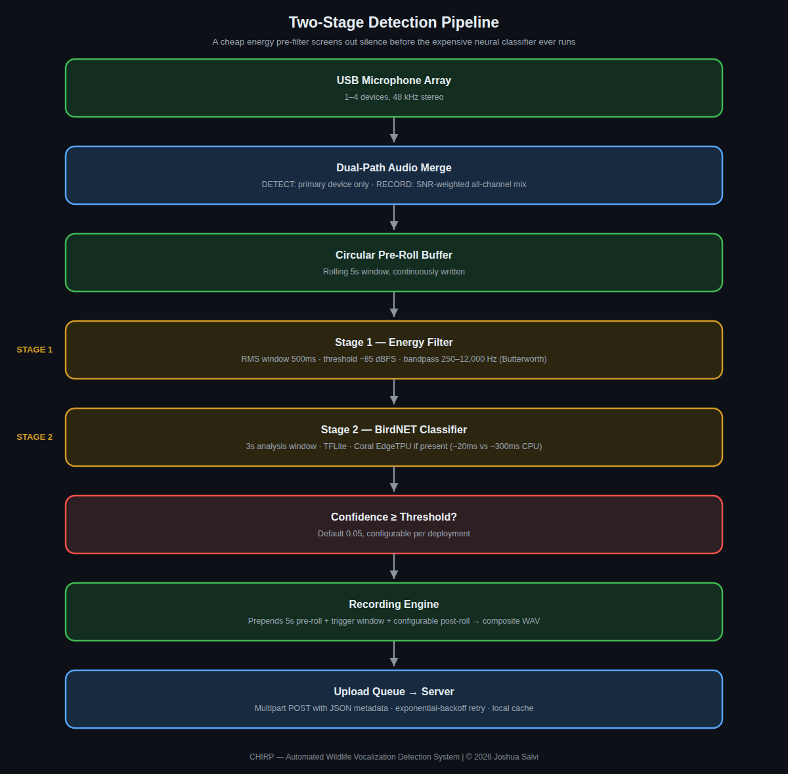
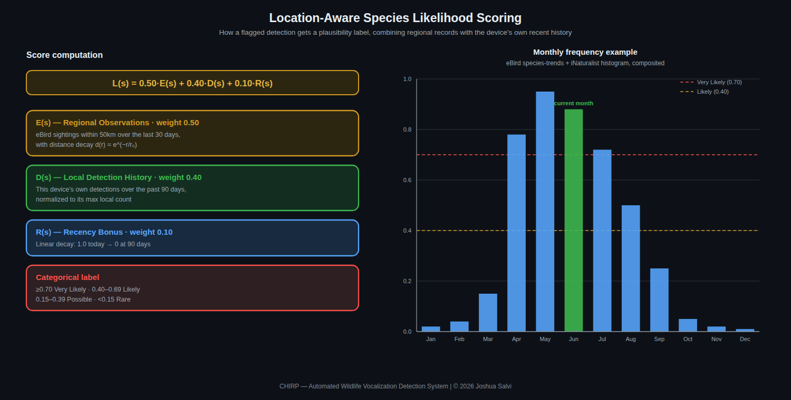

# Detection Pipeline

The core of Chirp's detection approach is a two-stage pipeline that runs
continuously on the edge device. The problem it solves: running a full deep
neural network classifier on every moment of audio, all day, is wasteful —
most of the time, nothing worth classifying is happening at all (wind,
silence, traffic, distant unrelated noise). A cheap, fast first-pass filter
screens out the overwhelming majority of audio before the expensive
classifier ever runs on it.

## Audio capture and merge

Audio comes in from every configured microphone simultaneously. Two
independent decisions get made from the same incoming audio:

- **Which audio to *analyze*** — a single primary device is used for
  detection, not a blend of all of them. Merging multiple microphones
  before analysis would risk phase cancellation or averaging away the
  signal that matters most.
- **Which audio to *save*** — the opposite approach: all channels are
  merged, weighted by real-time signal quality, so the final saved
  recording reflects whichever microphone captured the clearest version
  of the event, without needing that decision made in advance.

## Circular pre-roll buffer

A continuously-overwritten buffer holds the last several seconds of audio
at all times, regardless of whether anything has triggered a recording
yet. When Stage 2 confirms a detection, this buffer is prepended to
whatever gets saved — without it, a recording would start exactly at the
moment of detection, cutting off however much of the vocalization
happened just before the trigger fired.

## Stage 1 — Energy filter

A cheap, fast pass over every incoming audio window: compute the RMS
(root-mean-square) energy within a real-time bandpass-filtered range
matching typical bird vocalization frequencies, and compare it against a
minimum threshold. Audio below the threshold is discarded immediately —
no further processing, no neural network involvement. This stage runs on
essentially every chunk of incoming audio and is cheap enough to do so
continuously without meaningfully loading the CPU.

The current values:

| Parameter | Value |
|---|---|
| RMS window | 0.5 s |
| Threshold | −90.0 dB (relative full-scale) |
| Bandpass range | 150–12,000 Hz |
| Measured over | loudest 0.5 s sub-window of each 3 s window |
| Filter | 4th-order Butterworth |

## Stage 2 — BirdNET classifier

Only audio that survives Stage 1 reaches the neural network
classifier (BirdNET, running as a TFLite model). This is the expensive
step — full inference, not only a threshold check — so gating it behind
Stage 1 is what makes continuous, always-on detection practical on
modest edge hardware.

If a Coral USB EdgeTPU accelerator is present, inference runs on it
instead of the CPU — a meaningful speed difference (roughly 20ms vs.
roughly 300ms per window on CPU), though the EdgeTPU is an optional
hardware accelerator, not a requirement; the same classifier runs either
way, only faster with it present.

- Analysis window: 3 seconds (BirdNET's expected input length)
- Minimum confidence: 0.05 by default, configurable per deployment (lowered from an earlier 0.25 default to catch more/quieter detections)
- Location filter (CPU backend, when the device has a latitude and longitude): the same rule as the server pass below — species expected that week at 0.03 or more, plus night callers whose best week of the year reaches 0.0015 (owls) or 0.005 (others). Before device 1.3.1 it used birdnetlib's filter, which dropped owls the location model scores under 0.03 (Barred Owl in eastern Massachusetts in autumn: 0.016). The Coral backend applies the same filter from device 1.3.2

## Confidence gate and recording

A classification only becomes a recorded detection if its
confidence meets the configured minimum. Below that, the system discards
the result and keeps monitoring — no recording, no upload, no database
entry. Above it, the Recording Engine assembles the final clip (pre-roll
+ trigger window + a configurable amount of post-roll) as a single
composite WAV file, and hands it to the upload queue.

## Upload

Recordings upload to the server as a multipart POST with a JSON metadata
sidecar (device ID, timestamp, detected species, confidence, and so on).
If the upload fails — network outage, server unreachable — it retries
with exponential backoff and caches locally in the meantime, so a
temporary connectivity gap doesn't lose any detections; they arrive
late once the connection recovers.

## Server BirdNET pass

Every server-side analysis (device uploads, manual uploads, Re-analyze,
Live Detect) runs through `app/services/birdnet_pass.py`. It scores
BirdNET's TFLite model directly, in batches of 16 windows, with a pool of
interpreters (`CHIRP_BIRDNET_WORKERS`, `CHIRP_BIRDNET_THREADS`,
`CHIRP_BIRDNET_BATCH`). Its windows, sigmoid and sensitivity match
birdnetlib's exactly.

| Step | Rule |
|---|---|
| Confidence | Species need `birdnet_min_confidence`; night callers other than owls (nightjars, woodcock, rails, bitterns, night-herons) are kept down to 0.10; owls need 0.20. A per-species threshold (Settings → Night-Caller Near Misses) replaces these for that species |
| Location filter | BirdNET's location model at 0.03 for the recording's week. Night callers pass if their best week of the year reaches 0.0015 (owls) or 0.005 (others), since eBird checklists rarely include them. The 48-week lists are cached on disk per location |
| Owls (not Barn Owl) | Scored on a 200–2000 Hz copy of the audio, only in windows that could keep one (a hoot, a full-band owl of 0.45+, or an earlier owl detection). Kept when the window holds a hoot at a pitch that species uses (0.2–4 s, 5 dB above the audio just before or after it, which rules out engine harmonics) and the full band scores that owl 0.30 or more, best owl per window. A full-band score of 0.45+ that the band-limited copy supports at half or more stands without the hoot check. Device owls stay only when the server pass finds that owl too. A second owl species in one recording needs 0.70 |
| Near misses | Night callers that scored 0.03+ but weren't kept are stored per recording (best window each, with the reason) for setting per-species thresholds |
| Re-analysis | Each re-analysis stores the detections it replaced and what changed; the recording page lists them and can undo the newest. On compressed or AI-Enhanced audio, an earlier server detection keeps its earlier score if the new pass scores the same species and window within 0.15. AI-Enhanced re-analysis also scores the original audio and keeps the higher score per species and window. Default storage is FLAC, which re-analysis reads bit-for-bit |

The owl rules are tuned on a labeled set of 49 Xeno-canto clips (see
`scripts/owl-eval/README.md`): 81 of 96 owl cases found, 8 wrong owl
species, owls on 1 of 18 owl-free clips (0.5.9.h: 86, 80, 7).

## Server-side audio processing (playback)

Three independent, combinable-in-part options for listening to a
recording or clip on the server, generated on first request and cached
on disk from then on. Bird recordings only — none of these apply to bat
recordings, which use their own frequency downshift for audibility
instead (see [Hardware](hardware.md)).

| Option | What it does | Combinable with |
|---|---|---|
| **Enhanced** | Classical spectral-gating noise reduction (the `noisereduce` library) — learns a noise profile from the recording and suppresses it | Rumble Removed |
| **Rumble Removed** | A plain, single-pass high-pass filter — cuts low-frequency content (traffic, wind, HVAC) below a cutoff. Species-aware by default (150Hz for low-frequency callers like owls and doves, 800Hz otherwise, so the filter doesn't remove the bird along with the rumble); a manual 0–2000Hz slider in the UI overrides the automatic cutoff directly, matching Live Detect's own rumble filter | Enhanced |
| **AI Enhance** | A pretrained neural denoising model (biodenoising, Demucs-based, trained on animal vocalizations) — a full alternative processing path, not combined with the other two. Runs at 16kHz internally, so content above 8kHz in the result is lost; not a general substitute for Enhanced/Rumble Removed on recordings where preserving very high-frequency detail matters |

Rumble Removed and Enhanced can be toggled on together (their own
combined endpoint); AI Enhance always replaces both when it's on, since
it does its own noise suppression internally.
