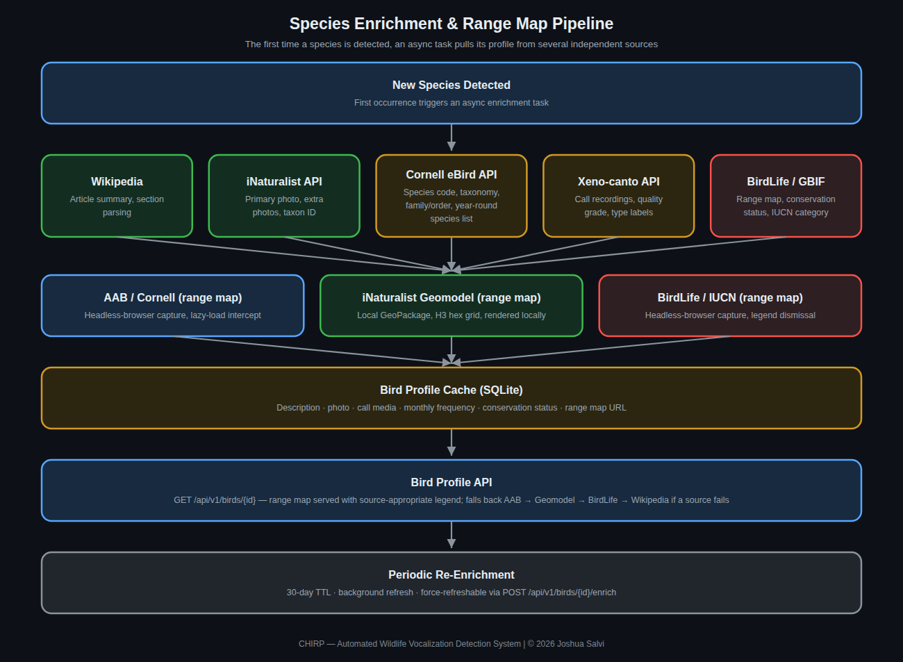

# Species Enrichment

Once BirdNET identifies a species (a raw common name and confidence
score), the server builds that into a full profile: description,
photos, reference audio, range map, taxonomy, and a set of quick-facts
tags. This happens once per species, not once per detection — after the
first detection of a species, its profile is cached and reused for every
subsequent detection of the same species.

The current sequence, in order:

1. **Wikipedia** — full article text for the species, used as the base
   description.
2. **iNaturalist** — photos and additional descriptive data.
3. **Cornell Lab of Ornithology / All About Birds** — a separate,
   detailed fetch covering habitat, food, nesting, and behavior tags, a
   set of specific "cool facts," and (a more recent addition) the
   species' measured length range, fetched from AAB's own
   Identification page rather than its Overview page — a genuinely
   separate page/tab requiring its own fetch.
4. **eBird** — taxonomy and species code, used to cross-reference other
   data sources consistently.
5. **iNaturalist (sounds)** — reference call/song audio clips for the
   species, so a person can compare what was detected against
   a known-good reference recording.

## Resilience

Enrichment pulls from several independent external services, any of
which can be temporarily unavailable, rate-limited, or blocked (Cornell
Lab's site in particular sits behind Cloudflare, which has occasionally
challenged automated requests). Each step is independent: a failure in
one source doesn't block the others, and a genuinely blocked fetch is
distinguished from "this source has no data for this species" so it can
be retried later rather than permanently giving up.

## Range maps

Range maps are fetched through a separate engine with multiple fallback
sources, so a map is still available for the vast majority of species
even when the primary source doesn't have one for a particular one.
