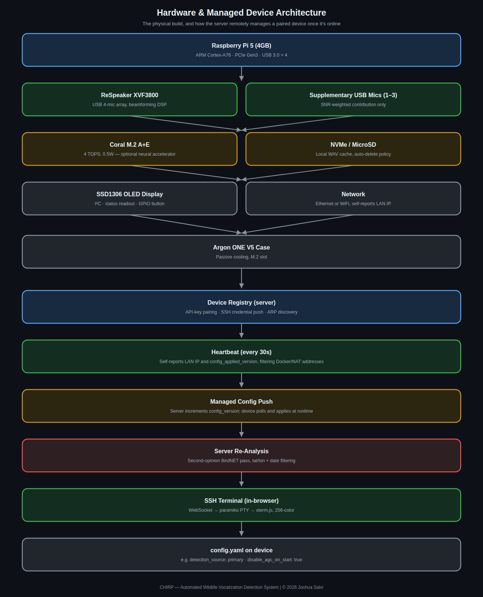

# Hardware & Edge Device

## Reference hardware

The primary reference deployment is a **Raspberry Pi 5** with local
NVMe storage, running a Python daemon (`chirp-device`) as the capture
and detection process. This isn't a hard requirement — anything capable
of running Python 3 and a USB audio stack could in principle work — but
it's what the software is actively developed and tested against.

Typical hardware requirements: Raspberry Pi 5 (4 GB+ RAM recommended),
1–2 USB microphones (see [Microphones](microphones.md)), and a 5V/5A
USB-C power supply. See [Device Setup Guide](device-setup.md) for a
full bill of materials and step-by-step assembly, including the
reference Argon ONE v5 Industria case.

Optional: a **Google Coral USB/M.2 Accelerator** (EdgeTPU), which
meaningfully speeds up Stage 2 classification (see
[Detection Pipeline](detection-pipeline.md)) but isn't required — the
same classifier runs on CPU if one isn't present, just slower per
window.

| Backend | Inference latency (per 3s window) |
|---|---|
| CPU (Pi 5) | ~150–400 ms |
| Coral EdgeTPU | ~20–50 ms (~8x faster) |

The Coral allows real-time continuous processing without audio gaps.
Supports USB Accelerator, M.2 A+E, M.2 B+M, and PCIe form factors — see
[Device Setup Guide](device-setup.md#google-coral-m2-bm-accelerator) for
installation.

## Microphone handling

Audio capture: 48kHz sample rate (matched to BirdNET's expected input
rate), mono per device, merged to a stereo output stream.

Multiple USB microphones can be connected simultaneously. Devices are
matched by a configurable list of name substrings (things like "USB",
"Microphone", specific brand names, "AudioMoth") — this is a permissive
default list, and there's a broader fallback scan over *all* connected input
devices (not just hint-matched ones) specifically so a legitimate
microphone with an unexpected name isn't silently missed.

A separate, independent exclude list removes specific devices from bird
detection entirely — useful for reserving a device for another purpose
(for example, a dedicated ultrasonic microphone used for bat detection
instead) even though it would otherwise match the general hints list.
Unlike the hints list, nothing is excluded by default; a device only
gets excluded if explicitly listed.

Up to a configurable maximum number of simultaneous input streams are
opened (4 by default) — enough headroom for a primary microphone plus a
few supplementary ones without unbounded resource use if many USB audio
devices happen to be plugged in.

See [Microphones](microphones.md) for model recommendations, ReSpeaker-
specific setup, and running a bird mic alongside a separate ultrasonic
mic for bat detection.

## OLED status display

The reference Argon ONE v5 Industria case includes a 128×32 SSD1306
OLED (I²C address `0x3C`) that rotates through status pages — current
detection counts, the most recent species, upload queue depth, system
health (CPU temp, RAM, disk, uptime), and active hardware backend. Fully
optional and non-blocking: if absent or if I²C fails, Chirp continues
running normally with a single log warning.

The case's own bundled OLED daemon (`argononed.service`) drives the same
physical screen and will win control of it if left running — the
installer disables that daemon automatically so Chirp's own display
takes over. See [Device Setup Guide](device-setup.md#oled-display-industria-panel)
for setup, configuration, and the daemon-conflict trade-off (it also
controls the case's physical power button).

## Server-managed config

When paired with the Chirp Server, the device polls for config updates
every 60 seconds and sends a heartbeat every 30 seconds so the server
shows live status. Admins can push config changes from the Devices page
without needing SSH access to the device at all.

## Location configuration

BirdNET can optionally filter its species list to what's
plausible at a given latitude/longitude and time of year. Without this,
it evaluates against its full global species list and will confidently
report species that don't occur anywhere near the deployment — with it
set, results are scoped to what's realistically expected locally. This
value is normally pushed automatically from the server's own location
setting rather than configured separately on each device.
