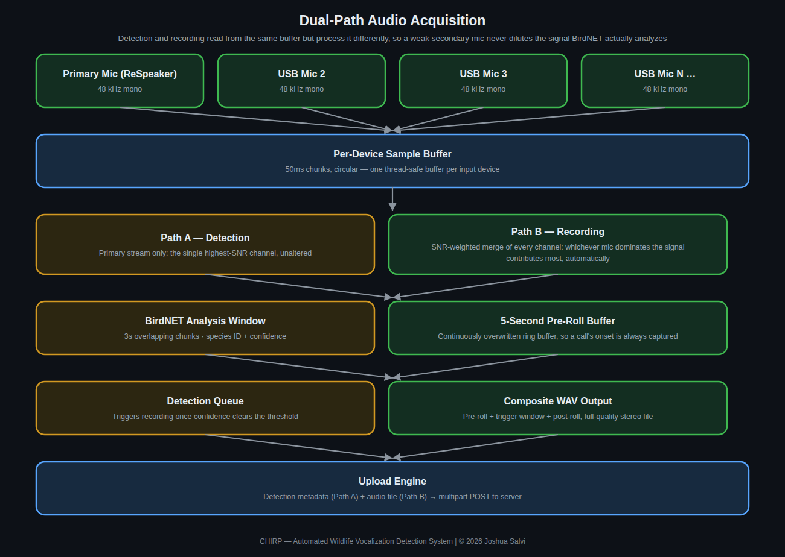
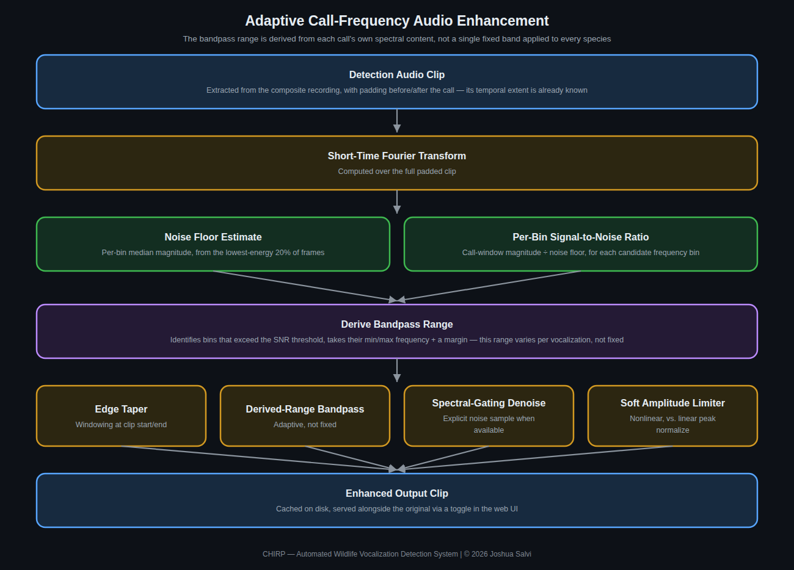
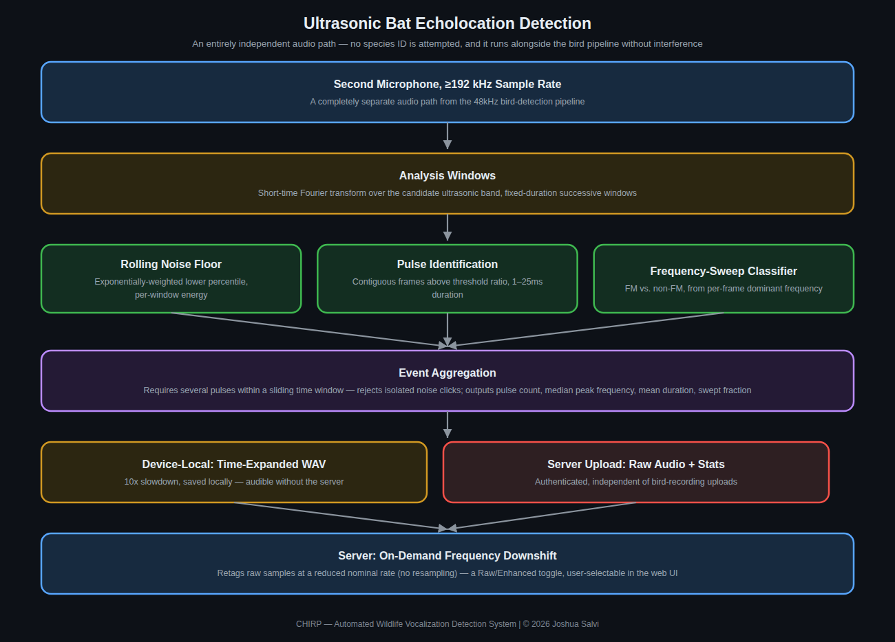

# Microphones

Chirp's default and most-tested microphone is the ReSpeaker USB 4-Mic
Array (XVF3000/XVF3800), but any USB Audio Class microphone works, and
several alternatives are meaningfully better on paper for one metric or
another. This page covers picking one, setting up the ReSpeaker
specifically, and combining a bird mic with a separate ultrasonic mic
for bat detection.

## Why not a beamforming/voice-array mic

Beamforming/voice-array mics are good hardware, but the wrong tool for
omnidirectional bird call capture. Beamforming DSP is designed to
isolate sound from *one* direction (a person talking to a voice
assistant) and suppress everything else — the opposite of what you want
for catching calls from birds in any direction around the device. This
isn't a guess: it's the consistent recommendation from the BirdNET-Pi
community (a much larger, longer-running version of this same setup) —
see [their microphone discussion](https://github.com/mcguirepr89/BirdNET-Pi/discussions/39),
where an ornithologist on the project makes the case in detail.

**If you're using the ReSpeaker USB Mic Array:** Chirp already avoids
this problem by default — `respeaker.py` reads the 4 raw per-capsule
channels (the default 6-ch firmware) and averages them to mono,
bypassing the chip's onboard voice-isolation DSP entirely. The one thing
to check: if you've specifically flashed the *1-channel* firmware
variant, that single output channel **is** the beamformed signal —
switch back to the default 6-ch firmware if so.

**If you're using the ReSpeaker XVF3800:** its stock 2-channel USB
firmware sends the voice pipeline (AEC, beamforming, noise suppression,
AGC) on the left channel. With `respeaker.xvf3800_output: raw` (the
default since device 1.2.30) Chirp re-routes the USB channels to raw
capsules 0 and 2 over the chip's control interface and averages them.
On the 6-channel firmware (`respeaker_xvf3800_usb_dfu_firmware_6chl_*`)
the four raw capsules are already on channels 3–6, so no routing change
is needed. Switch between Raw and Processed on the Devices page; it
applies without a restart. The routing isn't saved to the chip's flash,
so unplugging the array restores its default.

## Full comparison

The ReSpeaker XVF3800 publishes a 64 dBA SNR spec, not a self-noise
figure — it's a digital MEMS array with on-chip DSP (AEC/AGC/
beamforming/noise suppression), so its numbers aren't measured the same
way as a plain analog capsule's. Several fields below aren't published
by the manufacturer in a directly comparable form (marked accordingly)
rather than guessed at, and "effective range" isn't a standardized spec
across this category — it depends on the sound source's own
loudness/directivity and whether a reflector is involved.

| Mic | Cost | Interface | Directionality | Self-noise | SNR | Effective range | Key features |
|---|---|---|---|---|---|---|---|
| **ReSpeaker XVF3800** *(Chirp default)* | ~$50 | USB (Audio Class 2.0) | 4-mic circular array — omnidirectional with digital beamforming/DoA (steerable, not a fixed pattern) | Not published (digital MEMS array) | 64 dBA | N/A — array + beamforming behavior, not a simple mic spec | On-chip AEC/AGC/noise suppression, 5m far-field pickup, plug-and-play, 16kHz max sample rate (a real ceiling for high-pitched calls) |
| **AudioMoth USB Microphone** | ~$50–70 | USB | Omnidirectional | Not officially published — measured higher than dedicated recorders in an independent comparison study | Not published | Short-range general nature recording | Purpose-built for unattended bioacoustic work; already used for bats in Chirp; supports external mic input on newer versions |
| **Primo EM272Z1** *(Clippy/Pluggy)* | ~$100–150 | 2-wire plug-in-power (mini) or XLR w/ phantom power (Pluggy) | Omnidirectional | 14 dBA | 80 dB @ 1kHz | Close-range/clip-on; extends well with a parabolic reflector | Best noise-per-dollar in field recording; tiny 10mm capsule; widely used DIY/semi-pro standard |
| **Sennheiser MKH 8020** | ~$1,500+ | XLR, needs 48V phantom power | Omnidirectional (cardioid/supercardioid modules also available in the 8000 series) | 10 dBA (DIN, A-weighted) | Not published as one number — excellent dynamic range instead | Flat response and low noise hold up at distance in quiet settings | RF condenser design (immune to humidity noise other condensers get); 10Hz–60kHz response; modular capsule system |
| **Wildlife Acoustics Song Meter SM4** | ~$700–900 | Standalone recorder — 2 built-in mics + 2 cabled mic/hydrophone ports | Omnidirectional (built-in); cabled mic optional for distant placement | Not published separately from SNR | 80 dB typ. @ 1kHz (1 Pa, A-weighted) | Every +6dB of SNR roughly doubles usable detection distance (WA's own rule of thumb) | Fully standalone (no Pi needed) — weatherproof, D-cell battery (up to 650hrs), dual SD failover, scheduled recording |
| **Dodotronic Ultramic 192K** | ~$250–280 | USB (Audio Class, plug-and-play) | Omnidirectional | "Low noise" (no dB figure published) | Not published | Short-range point-source ultrasonic detection (bats, insects, rodents) | Purpose-built ultrasonic USB mic, 192kHz sampling, 16-bit — a genuine drop-in upgrade over AudioMoth for the bat pipeline specifically |

**Bottom line:** for the bird pipeline, the EM272Z1-based mics are the
standout value — a fraction of the MKH 8020's price for self-noise
within striking distance of it. For the bat pipeline, the Dodotronic
Ultramic is the most direct upgrade over the stock AudioMoth. For a
completely separate, no-Pi-required deployment, the Song Meter SM4 is
the industry-standard standalone option.

## Other plug-and-play options worth knowing about

Beyond the comparison table above, these come up often in the
community and are worth considering depending on budget:

1. **Best value setup (~$100 total):** a lavalier mic built on the
   Primo EM172 or EM272 electret capsule (very low self-noise, ~14–15
   dBA) connected via a USB audio interface that supplies plugin/phantom
   power — see [this writeup](https://www.dzombak.com/blog/2025/07/recommendation-microphone-setup-for-birdnet-pi/)
   for a specific tested combination. Omnidirectional, no in-mic "voice
   enhancement" DSP to fight against.
2. **Simpler one-box option (~$90):** Blue Yeti Nano set to
   omnidirectional pickup pattern — plug-and-play USB, no audio
   interface needed, flat response out to ~18kHz, decent SNR. The
   easiest upgrade path if you don't want a separate audio interface +
   lavalier cable.
3. **Budget/starter:** any plug-and-play USB mic explicitly sold as
   *omnidirectional* (Boya and Saramonic lavalier-style USB mics come up
   often in the community). Avoid generic unbranded USB desktop mics —
   frequency response typically rolls off well before 10kHz, well short
   of where many bird calls live.

Additional plug-and-play options that show up in Chirp's device-name
hints list by default:

| Mic | Price | Notes |
|---|---|---|
| Blue Snowball iCE | ~$50 | Omnidirectional, already in Chirp's device hints, widely Pi-compatible |
| Audio-Technica ATR2100x-USB | ~$80 | Low noise floor, cardioid — good for a fixed directional position |
| Rode NT-USB Mini | ~$100 | Excellent preamp quality, "Rode" in device hints, auto-detected |
| Samson Go Mic | ~$40 | Compact, omnidirectional, USB |
| Rode Wireless GO II (with USB-A adapter) | varies | Good sensitivity, can be placed at distance from the Pi itself |

### Outdoor mounting

Whatever mic you use outdoors, protect it with a simple rain baffle — a
PVC pipe cap with a mesh screen keeps water out while allowing 360°
sound in. The ReSpeaker's circular enclosure handles light rain well if
mounted under an eave. For full exposure, wrap it in a windscreen "dead
cat" foam cover (available for ~$10).

## ReSpeaker setup

### Which form factor do you have?

| Device | Connection | Driver needed? | Install script |
|---|---|---|---|
| ReSpeaker USB Mic Array v2.0/v2.1 | USB cable | No | `install.sh` (standard) |
| ReSpeaker USB 4-Mic Array XVF3800 | USB cable | No | `install.sh` (standard) |
| ReSpeaker 2-Mics Pi HAT | GPIO header (40-pin) | Yes | `install-respeaker-hat.sh` |
| ReSpeaker 4-Mic Array HAT | GPIO header (40-pin) | Yes | `install-respeaker-hat.sh` |
| ReSpeaker 4-Mic Linear Array Kit | GPIO header (40-pin) | Yes | `install-respeaker-hat.sh` |
| ReSpeaker 6-Mic Circular Array Kit | GPIO header (40-pin) | Yes | `install-respeaker-hat.sh` |

If you have the circular ReSpeaker with a USB cable (XVF-3000 or
XVF-3800 chip, with case), it's a USB plug-and-play device — no driver
installation needed, just plug it into any USB port on the Pi and Chirp
detects it automatically. Don't run `install-respeaker-hat.sh` for this
variant (that's only for the GPIO HAT variants). The LED ring flashes
green on every bird detection (requires `pyusb`, installed by
`install.sh`), and all 4 mic channels are mixed to mono automatically
for BirdNET.

### Can I just plug it into the Pi's USB port?

Yes, completely. The ReSpeaker USB Mic Array uses USB Audio Class 1.0
and appears as a generic USB microphone to any application — no
drivers, no setup, on any OS. To use it standalone without Chirp:

```bash
# List audio input devices
arecord -l

# Record 10 seconds of audio (replace N with card number from arecord -l)
arecord -D plughw:N -f S16_LE -r 16000 -c 1 -d 10 test.wav

# Set as system default (edit ~/.asoundrc):
defaults.pcm.card N
defaults.ctl.card N
```

For Chirp, just run `install.sh` as normal — `respeaker.mode: auto` in
`config.yaml` handles detection automatically.

### Verify Chirp sees your ReSpeaker

```bash
source venv/bin/activate
python main.py --list-devices
# Should show: ★ ReSpeaker  next to the device

python main.py --respeaker-info
# Shows full probe details, channel plan, LED status

python main.py --test-audio
# Shows live dB levels — talk/clap near the mic to verify
```

### HAT variants: install the driver first

HAT variants require the seeed-voicecard kernel driver. Chirp uses
HinTak's Pi 5–compatible fork automatically:

```bash
chmod +x install-respeaker-hat.sh
./install-respeaker-hat.sh
sudo reboot   # required
```

!!! warning "Pi 5 note"
    The original Seeed driver doesn't support the Pi 5's RP1 I²S
    controller. The HAT installer uses HinTak's fork, which does.

After reboot:

```bash
arecord -l                       # should show seeed-voicecard or ac108
python main.py --list-devices
```

### Channel layouts by model

| Model | ALSA channels | Valid mic channels | How Chirp uses it |
|---|---|---|---|
| USB v2.0/v2.1 (1-ch firmware) | 1 | 0 | Direct mono |
| USB v2.0/v2.1 (6-ch firmware, default) | 6 | 0,1,2,3 | Average 4 mic channels → mono |
| XVF3800 (2-ch firmware), raw | 2 | 0,1 (mic 0, mic 2) | Average → mono |
| XVF3800 (2-ch firmware), processed | 2 | 0 | Left (processed beam) only |
| XVF3800 (6-ch firmware), raw | 6 | 2,3,4,5 | Average 4 raw capsules → mono |
| 2-Mics HAT (WM8960) | 2 | 0,1 | Average 2 mics → mono |
| 4-Mic Array HAT (AC108) | 4 | 0,1,2,3 | Average 4 mics → mono |
| 4-Mic Linear Array (2×AC108) | 8 | 0,1,2,3 | Average 4 mics → mono (ch4-7 discarded) |
| 6-Mic Circular (2×AC108) | 12 | 0,1,2,3,4,5 | Average 6 mics → mono (ch6-11 discarded) |

### LED ring (USB mic array only)

The USB array has a 12-pixel APA102 LED ring. Chirp flashes it green on
detection.

```bash
# Test LED colors manually:
python main.py --respeaker-leds 0,200,80    # green
python main.py --respeaker-leds 200,80,0    # amber
python main.py --respeaker-leds 0,0,200     # blue
python main.py --respeaker-leds 0,0,0       # off
```

If LEDs don't respond, add udev rules for USB access:

```bash
sudo tee /etc/udev/rules.d/65-respeaker.rules << 'EOF'
SUBSYSTEM=="usb", ATTRS{idVendor}=="2886", ATTRS{idProduct}=="0018", MODE="0666"
SUBSYSTEM=="usb", ATTRS{idVendor}=="2886", ATTRS{idProduct}=="0019", MODE="0666"
SUBSYSTEM=="usb", ATTRS{idVendor}=="2886", ATTRS{idProduct}=="001b", MODE="0666"
EOF
sudo udevadm control --reload-rules && sudo udevadm trigger
```

### config.yaml: ReSpeaker settings

```yaml
respeaker:
  mode: auto                          # auto | usb | hat | disabled
  xvf3800_output: raw                 # XVF3800: raw | processed | unchanged
  led_on_detection: true              # Flash LED ring on bird detection
  led_color_idle: [0, 0, 0]          # Off when idle
  led_color_detection: [0, 200, 80]  # Green flash on detection
  led_flash_seconds: 3.0
```

`mode: auto` tries USB first, then HAT — works for most setups with no
changes.

Check the XVF3800 routing on the Pi:

```bash
cd ~/chirp-device && venv/bin/python -m chirp.xvf3800 status   # mode, AUDIO_MGR_OP_L/R, mic gain
venv/bin/python -m chirp.xvf3800 raw                    # or: processed
```

USB control needs the udev rule `install.sh` adds
(`/etc/udev/rules.d/99-chirp-respeaker.rules`, vendor 2886, group plugdev).

### ReSpeaker troubleshooting

**USB ReSpeaker not detected:**

```bash
lsusb | grep -i "2886\|seeed\|xvf"   # should show the device
python main.py --list-devices          # check sounddevice sees it
```

If `lsusb` shows it but `sounddevice` doesn't, add the udev rules above.

**Audio overflow warnings:**

```yaml
audio:
  chunk_size: 16384   # was 8192
```

**HAT not detected after reboot:**

```bash
dmesg | grep -i "seeed\|ac108\|wm8960" | tail -20
cat /proc/asound/cards
```

If empty, the driver didn't load — re-run `install-respeaker-hat.sh`.

## Dual-path audio



Chirp opens all connected mics through two independent logical paths:

- **Detection path** — the primary mic only, used for real-time
  BirdNET analysis.
- **Recording path** — every connected mic, merged via SNR-weighted
  mixing (`snr_weighted_merge()`): whichever mic has the stronger signal
  at any given moment automatically dominates the mix, so a
  supplementary mic can only help, never dilute, recording quality.

## Running a bird mic and an AudioMoth together (bat detection)





`config.yaml`'s default `device_name_hints` and
`detection.bat_echolocation.device_name` are set up for a ReSpeaker +
AudioMoth USB Microphone combo (the cheapest mic that also covers bat
echolocation, ~$80–100 — see `bat_echolocation`'s config comments for
the full price range up to ~$800). With both plugged in:

- **For bird detection:** both mics get opened and merged via
  `snr_weighted_merge()` as described above — the AudioMoth can only
  help, not dilute, bird-call quality.
- **For bat detection** (off by default — see `bat_echolocation.enabled`
  in `config.yaml`): the AudioMoth is matched separately and exclusively
  for the ultrasonic pipeline, at its own much higher sample rate. No
  resampling is applied — resampling would defeat the purpose of
  ultrasonic capture.

These are two independent `sounddevice` streams opened to the same
physical device. Most USB Audio Class hardware (AudioMoth included)
tolerates this fine, but it depends on your specific ALSA/PortAudio
setup — if you hit a "device busy" error with bat detection enabled,
dedicate the AudioMoth to one role: remove it from `device_name_hints`
to free it for bat-only use, or set `bat_echolocation.enabled: false` to
keep it bird-only. The ReSpeaker alone already handles bird detection
well, so bat-only is a reasonable default resolution if you hit that
conflict.
